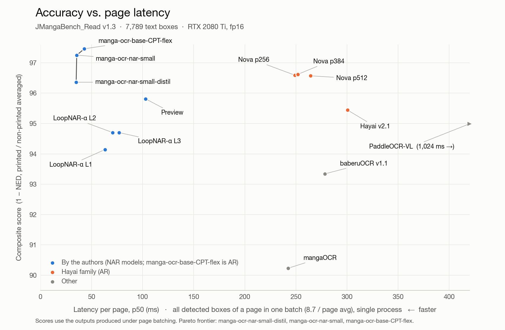
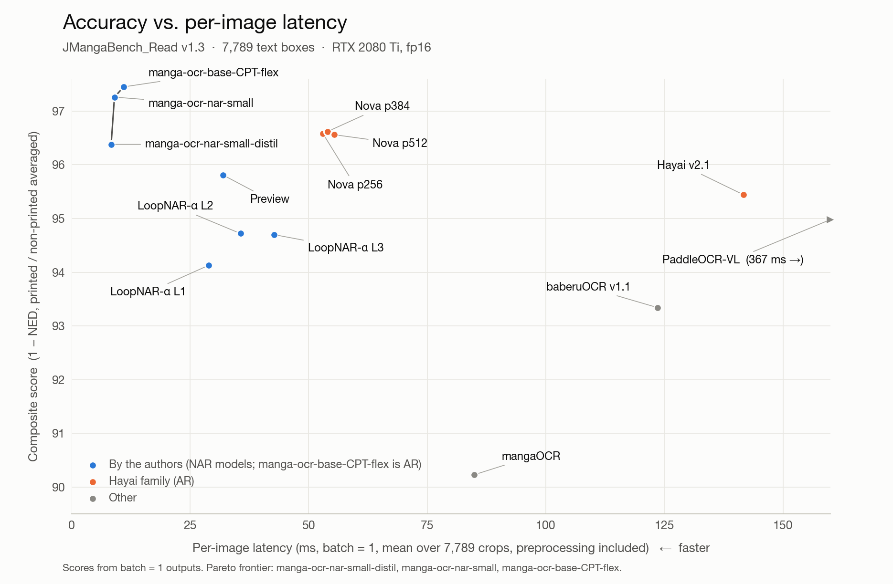

# JMangaBench_Read v1.3 — a Japanese manga OCR benchmark

[English](README.md) | [中文](README_zh.md) · [Appendix](APPENDIX.md) · [Interactive leaderboard](https://muscgab.github.io/JMangaBench_Read/) · [Dataset (images)](https://huggingface.co/datasets/muscgab/JMangaBench_Read)

JMangaBench_Read evaluates the accuracy and speed of OCR models on text boxes cropped from Japanese manga pages. The main set contains the text a reader reads and a translation pipeline translates: speech, narration and asides. Sound effects are excluded.

- 7,789 text boxes from 1,847 pages by 1,847 artists (one page per artist).
- All pages first posted between 2025-10-01 and 2026-10-01.
- Labels from three LLM readers and human review (1,266 boxes human-confirmed).
- Speed measured per image, per page and at maximum throughput on one RTX 2080 Ti.

Found an error in a label, a score or the docs? Please [open an issue](https://github.com/muscgab/JMangaBench_Read/issues). Corrections are welcome.

**v1.3 changes.** 4,660 new boxes from 1,116 new pages; 13 v1.2 boxes removed (rules in [Box selection and labeling](#box-selection-and-labeling)); scoring normalization renamed RIN v1 with two added symbol rules; all models re-measured on an RTX 2080 Ti in fp16. The authors used Read v1.2 and 1,021 of the new boxes during model development (see [Development use](#development-use)); scores on the 4,660 new boxes are reported separately in the [appendix](APPENDIX.md#a1-accuracy-by-subset). Full list: [appendix A6](APPENDIX.md#a6-version-history).

## Leaderboard

Ranked by composite score (defined in [Scoring](#scoring)). 7,789 boxes, RTX 2080 Ti, fp16.

| # | Model | Arch | Params | Composite ↑ | CER % ↓ | EM % ↑ | EM NFKC % ↑ | Per-image ms ↓ | Per-page ms (p50) ↓ | Max img/s ↑ |
|---|---|---|---|---|---|---|---|---|---|---|
| 1 | manga-ocr-base-CPT-flex † ¶ | AR | 111M | **97.45** | 1.53 | 91.42 | 80.60 | 11.0 | 43.0 | 260 (b32) |
| 2 | manga-ocr-nar-small † | NAR | 54M | **97.26** | 1.73 | 91.09 | 80.34 | 9.1 | 35.5 | 299 (b48) |
| 3 | Hayai v2.5 Nova p384 | AR | 157M | **96.62** | 2.40 | 88.00 | 75.59 | 54.0 | 252.0 | 175 (b48) |
| 4 | Hayai v2.5 Nova p256 | AR | 157M | **96.58** | 2.97 | 86.99 | 74.84 | 53.0 | 249.1 | 194 (b40) |
| 5 | Hayai v2.5 Nova p512 | AR | 157M | **96.56** | 2.37 | 87.91 | 75.27 | 55.4 | 264.4 | 111 (b40) |
| 6 | manga-ocr-nar-small-distil † ∥ | NAR | 30M | **96.38** | 2.32 | 88.83 | 78.57 | 8.4 | 35.0 | 287 (b48) |
| 7 | Preview † | NAR | 196M | **95.81** | 2.95 | 85.40 | 78.51 | 31.9 | 103.0 | 91 (b16) |
| 8 | Hayai v2.1 | AR | 156M | **95.44** | 2.70 | 84.49 | 77.99 | 141.7 | 300.6 | 87 (b128) |
| 9 | PaddleOCR-VL-For-Manga | AR (VLM) | 959M | **94.98** | 2.03 | 87.52 | 53.15 | 366.6 | 1024.4 | 6.6 (b10) |
| 10 | LoopNAR-α L2 † ‡ | NAR | 50M | **94.72** | 3.33 | 83.62 | 74.09 | 35.6 | 70.8 | 243 (b48) |
| 11 | LoopNAR-α L3 † ‡ | NAR | 50M | **94.70** | 3.23 | 83.62 | 74.21 | 42.7 | 76.9 | 224 (b48) |
| 12 | LoopNAR-α L1 † ‡ | NAR | 50M | **94.13** | 3.95 | 81.95 | 72.64 | 29.0 | 63.2 | 259 (b56) |
| 13 | baberuOCR v1.1 | AR | 113M | **93.34** | 3.66 | 81.60 | 70.89 | 123.6 | 278.3 | 105 (b256) |
| 14 | mangaOCR | AR | 111M | **90.23** | 4.84 | 78.25 | 67.90 | 84.9 | 242.4 | 42 (b56) |
| – | GPT-6 Astra * | LLM | — | 99.47 | 0.24 | 98.04 | 93.40 | — | — | — |
| – | GPT-6.1 Sol * | LLM | — | 99.35 | 0.28 | 97.75 | 97.71 | — | — | — |
| – | Claude Opus 5.5 * | LLM | — | 98.05 | 0.59 | 95.58 | 88.33 | — | — | — |

<details><summary>More models</summary>

| # | Model | Arch | Params | Composite ↑ | CER % ↓ | EM % ↑ | EM NFKC % ↑ | Per-image ms ↓ | Per-page ms (p50) ↓ | Max img/s ↑ |
|---|---|---|---|---|---|---|---|---|---|---|
| – | e4 L3 † § | NAR | 54M | 97.29 | 1.73 | 90.97 | 80.07 | 42.8 | 71.9 | 227 (b32) |
| – | e4 L2 † § | NAR | 54M | 97.28 | 1.75 | 90.92 | 80.06 | 35.5 | 64.3 | 267 (b48) |
| – | e4 L1 † § | NAR | 54M | 97.14 | 1.96 | 90.40 | 79.66 | 28.3 | 58.1 | 282 (b24) |

</details>

- † Made by the authors of this benchmark (see [Conflict of interest](#conflict-of-interest)).
- ‡ Experimental model, not released. L1/L2/L3 = number of decoder loops, same weights.
- § e4: the authors' earlier mainline checkpoint (same architecture family as manga-ocr-nar-small, 3-loop training), released as a reference model ([muscgab/mangaocr-nar-looped-e4-exp](https://huggingface.co/muscgab/mangaocr-nar-looped-e4-exp)). L1/L2/L3 = decoder loops at inference.
- ¶ manga-ocr-base-CPT-flex: mangaOCR ([kha-white/manga-ocr-base](https://huggingface.co/kha-white/manga-ocr-base)) after continued pre-training by the authors on the training data of manga-ocr-nar-small; same architecture, a new 6,817-character vocabulary and aspect-preserving input (at most 196 patches). Timed with the CUDA path of its released package (CUDA graphs and GPU preprocessing), whose outputs equal the plain path on all 7,789 boxes; encoder fp16, decoder fp32. Its 224 × 224 sibling (manga-ocr-base-CPT) is not listed.
- ∥ manga-ocr-nar-small-distil: distilled from manga-ocr-nar-small (6 of its 12 encoder layers, decoder width 384, 30M parameters) and trained with int8 quantization. The GPU columns use its released CUDA backend, which simulates the int8 arithmetic in fp16 (CUDA graphs). On CPU it runs as int8 ONNX: on all 7,789 boxes, EM 88.92 and 37.3 ms per crop (p50, 8 threads, preprocessing included) on a Xeon Gold 6148 (u8u8); EM 88.91 and 21.0 ms per crop on an M1 Pro (u8s8).
- \* LLM readers. The agreed reading of all three defines 7,005 of the labels (all boxes outside hard), so these rows are listed for reference and are not ranked ([appendix A4](APPENDIX.md#a4-llm-reference-scores-not-ranked)).
- Accuracy columns use batch-size-1 outputs. Under per-page batching, composite scores change by at most 0.02.
- EM NFKC: exact match after Unicode NFKC only, for reference. The gap to EM comes mostly from spelling variants that RIN merges (see [Scoring](#scoring)).
- `bN`: batch size at maximum throughput.
- Params from the published weight files; mangaOCR estimated from its fp32 file size.
- Breakdowns by subset, length and role, the speed details and the NFKC results: [appendix](APPENDIX.md). Scores on the separate SFX set (380 boxes): [appendix A7](APPENDIX.md#a7-sfx-set).

### Accuracy vs. speed

Click a chart to open the interactive version (subsets: all / new / printed / non-printed / gold / hard; e4 under "More models").

[](https://muscgab.github.io/JMangaBench_Read/)

[](https://muscgab.github.io/JMangaBench_Read/)

Reading one page at a time with no wait between pages, the median time per page is 35 ms for manga-ocr-nar-small-distil, 37 ms for manga-ocr-nar-small, 50 ms for manga-ocr-base-CPT-flex, 245 ms for Hayai v2.5 Nova p384 and 345 ms for Hayai v2.1 ([appendix A2](APPENDIX.md#a2-speed-details)).

## Data

### Source

Black-and-white Japanese comic pages posted publicly online by independent artists, collected for research use. Source type and license follow [AnimeText](https://huggingface.co/datasets/deepghs/AnimeText).

| Rule | Value |
|---|---|
| Posting date | 2025-10-01 to 2026-10-01 (v1.2 pages up to 2026-03-10, new pages from 2026-03-10) |
| Artists | one page per artist, 1,847 artists |
| Color | black-and-white |
| Content rating | general (6,229 boxes), sensitive (1,560 boxes) |
| Language | Japanese |
| Excluded artists | those who publicly prohibit reposting or AI use |

### Overlap with AnimeText

All 1,847 pages were checked by image ID (dataset revisions of 2026-10-04).

- [AnimeText](https://huggingface.co/datasets/deepghs/AnimeText): 0 pages. Its 735,060 image IDs (train, valid, test) range up to 8,475,567, posted on 2024-11-23. The lowest page ID in this benchmark is 10,053,471.
- [animetext-ocr](https://huggingface.co/datasets/JustANormalTinkerer/animetext-ocr): 0 pages. Its 496,601 source image IDs range up to 8,475,560.

### Box selection and labeling

Boxes come from one candidate pool. Pages were processed in a fixed order; v1.2 covers the pages up to a cut-off and v1.3 adds the pages after it.

**1. Detection.** AnimeText YOLO12x detector, confidence ≥ 0.425. For nested boxes the smaller box is kept. General pages keep all boxes; sensitive pages keep up to 8 random boxes. Result: about 21,500 candidate boxes on 2,524 pages.

**2. LLM readers.** Each reader worked independently and did not see the other readers' outputs. Prompts: [appendix A3](APPENDIX.md#a3-llm-readers).

| Reader | Task | Boxes read |
|---|---|---|
| GPT-6.1 Sol | OCR of the full pool; font class (printed / handwritten / artistic); text role; first screening | 21,305 |
| GPT-6 Astra | OCR; admission decision; text role; language label | about 11,900 |
| Claude Opus 5.5 | final review: OCR from the crop only; text role; flags for boxes cut by the frame, mixed with other text, or not body text | 9,083 |

**3. Exclusions** (Sol screening and Astra admission):

- Scene text: shop names, station names, street signs, signboards, posters.
- Non-story text: ads, watermarks, signatures and credits, large titles.
- Large decorative sound effects (e.g. a giant ドドド).
- Damaged text: occluded, smeared, faded, blacked out, or heavily cut off.
- Non-Japanese text.

Hard-to-read, rare or deformed characters, long text, artistic lettering and low reader confidence are not exclusion criteria.

**4. Main-set rules.** Applied to all v1.3 boxes:

| Rule | Removed |
|---|---|
| Sound effects and mimetic words drawn outside balloons (majority role label of the three readers; v1.2 page-checked overrides kept) | not in the candidate set |
| Label contains a voicing mark on a character without a voiced form (e.g. あ゛, ん゛) | 16 (8 from v1.2, 8 new) |
| Moans or emphasis only, with no lexical content. Candidates: boxes without kanji that contain ♡, a small vowel, ゔ or a doubled character; each candidate judged by a human | 8 (5 from v1.2, 3 new) |

**5. Labels of the new boxes.**

| Case | Label | Boxes |
|---|---|---|
| Three readings identical after normalization, no Opus flag | agreed reading (Sol's spelling) | 4,232 |
| Readings differ (232 kept); readings agree but Opus flagged the box (151 kept); both (45 kept) | human decision: choose a reading, enter a new one, or drop the box (63 dropped) | 428 (hard) |
| Uniform random sample of agreed boxes, re-checked by a human | 300/300 correct | (included in the 4,232) |

v1.2 labels are unchanged. The review interface showed the three LLM readings only, never an OCR model's output.

**Label quality.** 0 errors in 300 audited new agreed boxes gives a one-sided 95% upper bound of 0.99% on their error rate (Clopper–Pearson); v1.2's audit gave 0 errors in 200 (bound 1.49%). The 6,523 labels without per-box human confirmation are verified by sampling only.

### Subsets

| Subset | Definition | Boxes |
|---|---|---|
| all | all boxes | 7,789 |
| new | boxes added in v1.3 | 4,660 |
| v1.2 kept | boxes carried over from v1.2 | 3,129 |
| hard | readers disagreed or Opus flagged the box; human-decided label | 784 |
| gold | all human-confirmed boxes (hard + random audits of v1.2 and v1.3) | 1,266 |
| printed | majority font label of the three readers is printed | 5,877 |
| non-printed | handwritten, artistic or mixed | 1,912 |

### Development use

The authors used Read v1.2 (3,142 boxes) as a development set for manga-ocr-nar-small and its predecessors: model selection, comparisons and error analysis. A second development set, "Sol handwriting" (2,248 boxes from the same candidate pool that GPT-6.1 Sol classified as handwritten, with LLM-reading labels), was used from 2026-10-09 for training-time validation, data and architecture comparisons and error analysis. It shares 1,021 boxes with the v1.3 new boxes: 1,004 of the 1,110 new non-printed boxes and 17 printed boxes. Aggregate statistics measured on the candidate pool, minus the v1.2 pages, informed the design of synthetic training data; those pool pages include the pages of the 4,660 new boxes. The statistics are released in [`docs/pool_stats/`](docs/pool_stats/). No image from the candidate pool or the benchmark was used for training. Scores on the new boxes are in [appendix A1](APPENDIX.md#a1-accuracy-by-subset); their non-printed part largely overlaps the Sol handwriting set. manga-ocr-base-CPT-flex was trained on the same training data as manga-ocr-nar-small; two of its intermediate checkpoints were scored on Read v1.3 during training for monitoring only, and the released weights are those of the last training step.

## Scoring

Predictions and labels are normalized with the same rules, **RIN v1** (reading-invariant normalization). RIN merges spelling variants that do not change what a reader reads.

| Rule | Example |
|---|---|
| width folding (full-width ASCII → half-width, half-width kana → full-width) | `！` → `!`, `ﾃｽﾄ` → `テスト` |
| remove whitespace | `あ い` → `あい` |
| pause-dot runs → `…` | `・・・`, `...`, `……` → `…` |
| long dashes → `ー`; `ー` runs → one `ー` | `──` → `ー` |
| wave marks → `〜`; `〜` runs → one `〜` | `～～` → `〜` |
| quote forms → `"` / `'` | `〝 〟` → `"` |
| voicing marks unified | `う゛` → `ゔ`, `あ゙` → `あ゛` |
| compatibility symbols (new in v1.3: `⁇`, `⊠`) | `⁉` → `!?`, `⁇` → `??`, `⊠` → `☒` |

Characters, small kana, brackets 「」『』, `〇` / `○` and the presence of a voicing mark are kept. Labels use `♡`; `♥` is not mapped. RIN v1 equals Read v1.2's `r7` plus the two v1.3 symbol rules; no v1.3 label changes between the two.

**Why RIN.** The labels follow the readers' spelling, which varies for the same glyph: `～` in 326 boxes and `〜` in 112, `…` in 1,832 boxes and `・・` runs in 260, `！` in 868 and `!` in 560. A model that writes each symbol one way cannot match all labels without normalization. EM after NFKC alone is listed for reference.

**Metrics**

- CER: total edit distance / total label characters.
- EM: fraction of boxes with an exact match.
- Composite (ranking metric), 1 − normalized edit distance as in ICDAR 2019 ReCTS, averaged equally over printed and non-printed boxes:

$$s_i = 1 - \frac{\mathrm{ED}(p_i, g_i)}{\max(|p_i|, |g_i|)}$$

$$\text{Composite} = 100 \times \tfrac{1}{2}\left(\overline{s}_{\text{printed}} + \overline{s}_{\text{non-printed}}\right)$$

## Speed

One RTX 2080 Ti (11 GB) per model, all models in fp16 (the card has no fast bf16). Each run is pinned to 8–10 CPU cores of a 2× Xeon Gold 6148 host, with library threads capped at 8; up to four models run at the same time, one per GPU. Images are pre-decoded in memory. Timings include the model's preprocessing and decoding and are GPU-synchronized.

| Measure | Method |
|---|---|
| Per-image latency | batch size 1, single process; mean over all 7,789 crops after warm-up |
| Per-page latency | 896 batches with sizes drawn from the real per-page box counts (mean 8.7, max 45); single process, preprocessing included; p50 of batch time |
| Max throughput | 512 crops; preprocessing in 4 worker processes in parallel with the GPU (main process: 3 threads); batch size searched up to the memory limit; median of 3 runs at the best batch size |
| One page at a time, first crop | [appendix A2](APPENDIX.md#a2-speed-details) |

Read v1.2 was timed on an RTX 3080 Ti with each model's default precision. Speeds of the two versions are not comparable.

After the GPU has been idle for several seconds, the driver lowers its clock and the next request is slower (for Hayai v2.5 Nova p384 51.5 → 81.7 ms on the first crop after 20 s idle). This applies to every model; see [appendix A2](APPENDIX.md#a2-speed-details).

## Models

| Model | Weights | Settings |
|---|---|---|
| manga-ocr-base-CPT-flex † | [muscgab/manga-ocr-base-CPT-flex](https://huggingface.co/muscgab/manga-ocr-base-CPT-flex) | encoder fp16, decoder fp32; the CUDA path of the inference package released with the model (CUDA graphs) |
| manga-ocr-nar-small † | [muscgab/manga-ocr-nar-small](https://huggingface.co/muscgab/manga-ocr-nar-small) | fp16; the inference code released with the model |
| manga-ocr-nar-small-distil † | [muscgab/manga-ocr-nar-small-distil](https://huggingface.co/muscgab/manga-ocr-nar-small-distil) | fp16 with simulated int8; the inference code released with the model |
| e4 † | [muscgab/mangaocr-nar-looped-e4-exp](https://huggingface.co/muscgab/mangaocr-nar-looped-e4-exp) | fp16 (training code); 1/2/3 decoder loops |
| LoopNAR-α † | not released | fp16; 1/2/3 decoder loops |
| Preview † | [muscgab/manga-ocr-nar-preview](https://huggingface.co/muscgab/manga-ocr-nar-preview) | fp16 |
| Hayai v2.1 | [JustANormalTinkerer/hayai-ocr-v2](https://huggingface.co/JustANormalTinkerer/hayai-ocr-v2) (main branch = v2.1) | 256 patches; greedy; fp16 |
| Hayai v2.5 Nova | [JustANormalTinkerer/hayai-ocr-v2.5-nova](https://huggingface.co/JustANormalTinkerer/hayai-ocr-v2.5-nova) | 256 / 384 / 512 patches; otherwise as above |
| PaddleOCR-VL-For-Manga | [jzhang533/PaddleOCR-VL-For-Manga](https://huggingface.co/jzhang533/PaddleOCR-VL-For-Manga) | fp16; greedy; prompt `OCR:`; batched with per-image vision attention, at most 16 crops per batch |
| baberuOCR v1.1 | [genshiai-daichi/baberu-ocr](https://huggingface.co/genshiai-daichi/baberu-ocr) (weights = tag v1.1) | fp16; README generation defaults (up to 256 tokens) |
| mangaOCR | [kha-white/manga-ocr-base](https://huggingface.co/kha-white/manga-ocr-base) | fp16; package defaults otherwise |

fp16 against fp32 on the same inputs: identical outputs for Preview (260/260), PaddleOCR-VL-For-Manga (65/65) and manga-ocr-nar-small (7,788/7,789); LoopNAR-α L3 EM 83.61 (fp16) vs 83.62 (fp32). The other models were not compared.

## Conflict of interest

manga-ocr-nar-small, manga-ocr-nar-small-distil, manga-ocr-base-CPT-flex, e4, LoopNAR-α and Preview are made by the authors of this benchmark.

- Labels come from three third-party LLMs and human review. The review interface showed LLM readings only, no OCR model outputs.
- Read v1.2 was used during the development of the authors' models ([Development use](#development-use)). 1,021 of the new boxes were in a development set before v1.3 was assembled. Box selection and labels do not use any OCR model output.
- All model predictions, the scoring script and the speed scripts are released.

## Limitations

- 6,523 labels are agreed LLM readings verified by sampling only.
- During human review the majority reading was pre-filled.
- The hard subset is defined by LLM disagreement and flags.
- Sound effects were excluded by LLM role labels; boxes labeled dialogue were not checked one by one.
- Boxes were screened by LLMs; boxes judged unreadable are not included.
- All boxes were cropped by one detector (AnimeText YOLO12x), which outputs tight text blocks. Scores may not transfer to other crop styles: whole speech bubbles (bubble detectors) or single text lines. Models trained on AnimeText-derived crops, including ours and Hayai, see a similar crop style in training.
- One source type (recent fan and original works), one GPU type.
- At the max-throughput batch size, outputs match batch-size-1 outputs for 99.6–100% of boxes.

## Usage

```bash
pip install regex
python eval/score.py --pred my_preds.jsonl --name my_model --out results/my_model.json
```

`my_preds.jsonl`: one line per box, `{"key": "10053471_0", "pred": "作戦を続行する"}`. Missing keys count as empty predictions.

| Location | Content |
|---|---|
| `data/gt.jsonl` | labels and metadata, 7,789 boxes |
| `data/llm_readings.jsonl` | three LLM readings per box |
| `data/predictions/` | outputs of all listed models (batch size 1 and per-page; `sfx_batch1/` for the SFX set) |
| `data/gt_sfx.jsonl` | v1.2 SFX set (380 boxes), labels unchanged; scores with the v1.3 setup in [appendix A7](APPENDIX.md#a7-sfx-set) |
| `eval/` | scoring script and RIN normalization code |
| `speed/` | speed scripts |
| [Hugging Face](https://huggingface.co/datasets/muscgab/JMangaBench_Read) | crop images at original resolution: `main/<key>.png` (split `test`) |

`gt.jsonl` fields: `key`, `file`, `text`, `text_rin`, `n_chars`, `gold`, `gold_hard`, `gold_random_audit`, `printed`, `non_printed`, `font`, `role`, `orientation`, `crop_wh`, `page_id`, `box`, `rating`, `origin` (`v1.2` / `new`), `review`.

For evaluation only. Do not use for training.

## Corrections

If you find any error (a wrong label, a box that should not be in the set, a scoring or speed problem), please [open an issue](https://github.com/muscgab/JMangaBench_Read/issues). Fixes go into the next version and are listed in [appendix A6](APPENDIX.md#a6-version-history).

## License

[CC BY-NC-SA 4.0](https://creativecommons.org/licenses/by-nc-sa/4.0/) for data and code.

## Citation

```bibtex
@misc{jmangabench_read,
  title  = {JMangaBench\_Read: A Japanese Manga OCR Benchmark},
  year   = {2026},
  url    = {https://github.com/muscgab/JMangaBench_Read}
}
```
